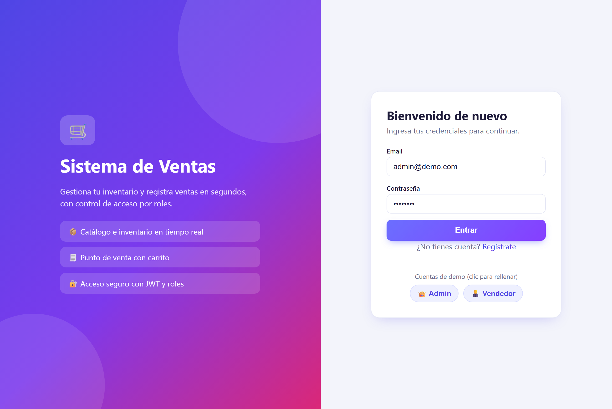
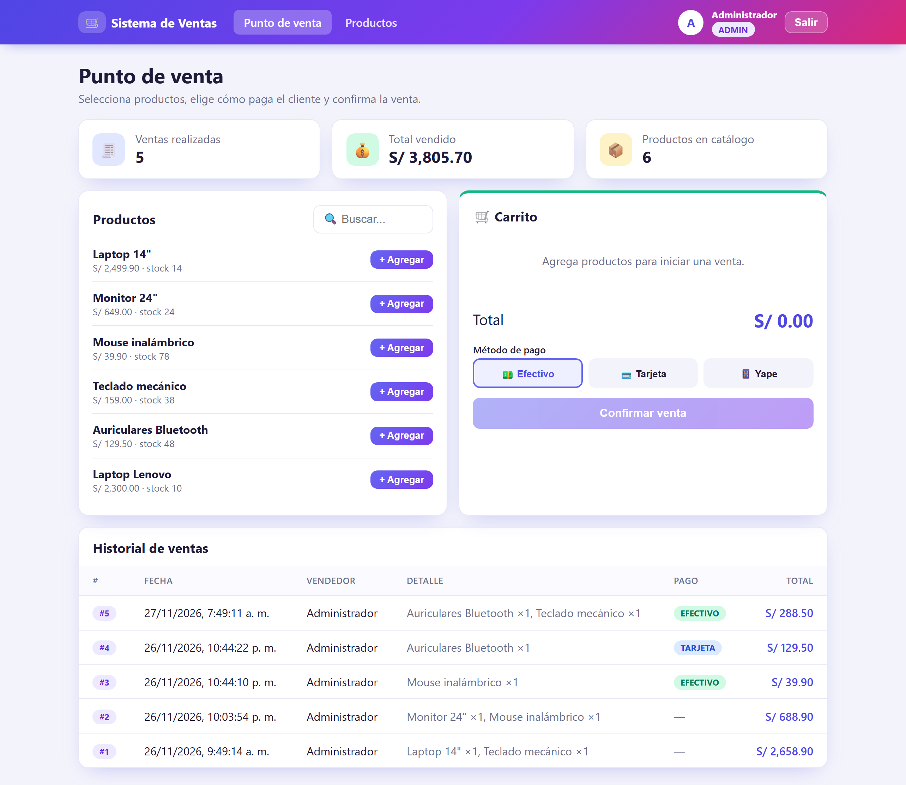
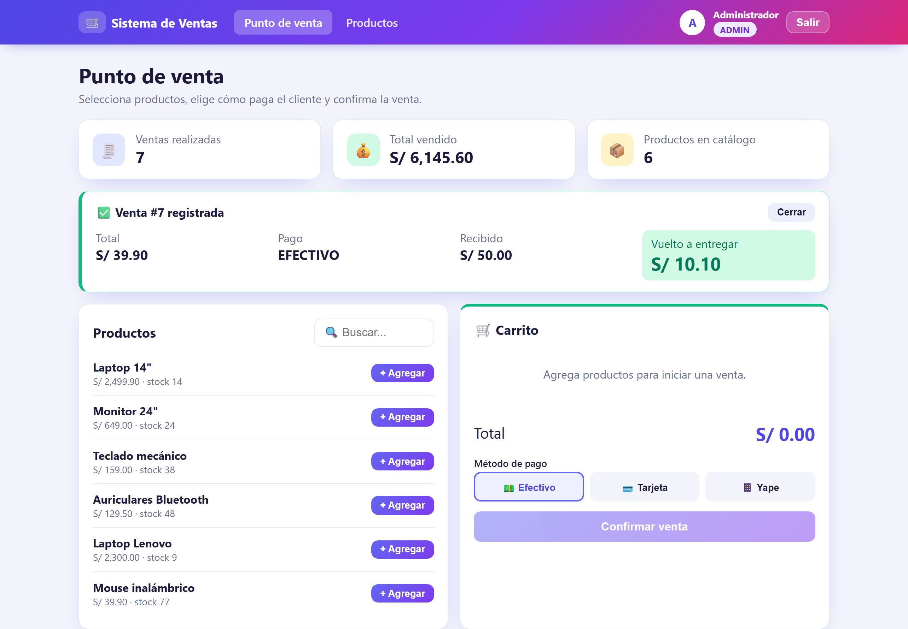
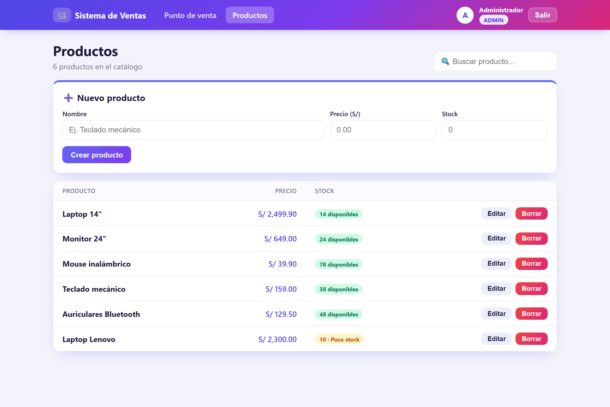

# Sistema de Ventas

Aplicación fullstack para gestionar productos y registrar ventas, con autenticación y roles.

**Stack:** Java 17 · Spring Boot 3 · Spring Security (JWT) · Spring Data JPA · PostgreSQL · Next.js 14 (TypeScript) · Docker

## 🎬 Demo

[](<LINK-DE-TU-VIDEO>)

▶️ **[Ver video de la demo](<LINK-DE-TU-VIDEO>)**

## 📸 Capturas

| Login | Punto de venta |
| --- | --- |
|  |  |

| Pago en efectivo | Gestión de productos |
| --- | --- |
|  |  |


## Funcionalidades

- Registro e inicio de sesión con **JWT** (contraseñas con BCrypt).
- **Roles**: `ADMIN` y `VENDEDOR`.
  - Catálogo de productos visible solo para usuarios autenticados (sin sesión se redirige al login).
  - Crear, editar y borrar productos: solo `ADMIN`.
  - Registrar ventas y ver historial: `ADMIN` y `VENDEDOR`.
- Registro de ventas **transaccional**: valida stock, descuenta inventario y calcula el total en el servidor.
  El precio de cada ítem se guarda en el momento de la venta.
- Pagos en **efectivo** (con cálculo de vuelto y validación en el servidor), tarjeta o Yape.
- Fechas guardadas en UTC y mostradas en la hora local de cada usuario.
- Validaciones de entrada y respuestas de error con formato uniforme.
- Tests de integración (MockMvc) que cubren seguridad, roles y lógica de ventas.
- CI con GitHub Actions (tests del backend + build del frontend).

## Arquitectura

```
Next.js (3000)  ──HTTP + JWT──▶  Spring Boot API (8080)  ──JPA──▶  PostgreSQL (5432)
```

```
backend/   API REST (controller → service → repository)
  security/   JwtService, JwtAuthFilter, UserDetailsService
  config/     SecurityConfig, manejo de errores, datos demo
frontend/  Next.js (App Router): login, catálogo, punto de venta
```

## Cómo ejecutarlo

### Con Docker (lo más simple)

```bash
docker compose up --build
```

- Frontend: http://localhost:3000
- API: http://localhost:8080/api/productos

### Sin Docker

1. Levanta PostgreSQL con una base `ventas` (usuario/clave `ventas`/`ventas`) o configura las variables `DB_URL`, `DB_USER`, `DB_PASSWORD`.
2. Backend: `cd backend && mvn spring-boot:run`
3. Frontend: `cd frontend && npm install && npm run dev`

### Usuarios de demo

| Rol | Email | Contraseña |
| --- | --- | --- |
| Admin | admin@demo.com | admin123 |
| Vendedor | vendedor@demo.com | vendedor123 |

## Endpoints

| Método | Ruta | Acceso |
| --- | --- | --- |
| POST | `/api/auth/register` | Público |
| POST | `/api/auth/login` | Público |
| GET | `/api/productos` | Usuario autenticado |
| POST / PUT / DELETE | `/api/productos[/{id}]` | ADMIN |
| POST | `/api/ventas` | ADMIN, VENDEDOR |
| GET | `/api/ventas` | ADMIN, VENDEDOR |

